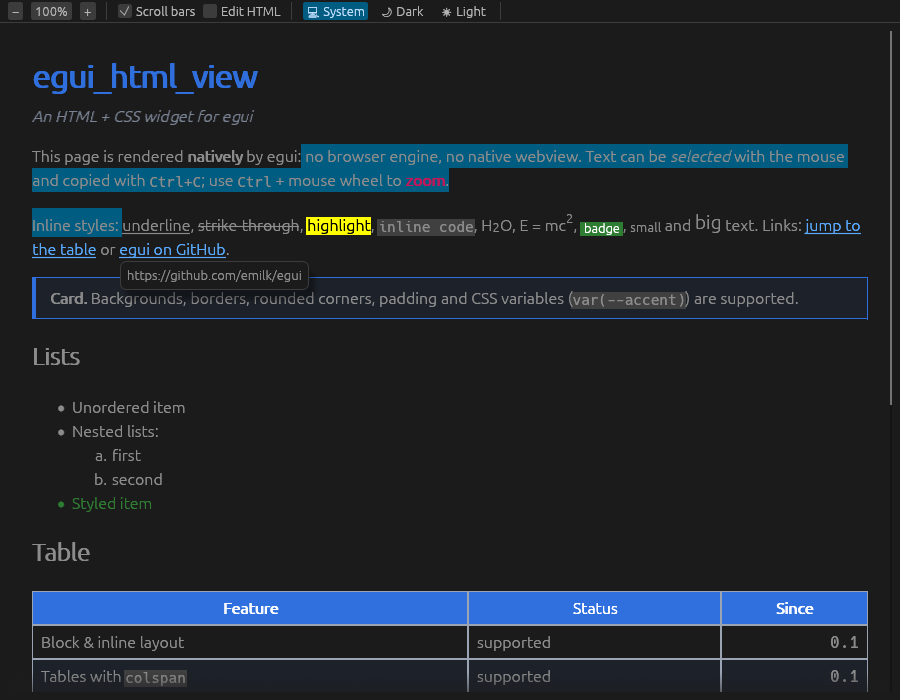

# egui_html_view

Виджет для [egui](https://github.com/emilk/egui) 0.36, который рисует HTML + CSS:
необязательные скроллбары, масштабирование, стили, выделение и копирование текста.



## Почему это не «настоящий» webview

Нативный webview (WebView2, WKWebView, WebKitGTK, например через `wry`) — это отдельное
системное окно поверх окна приложения. egui не может его обрезать скролл-областью,
масштабировать вместе с остальным UI или нарисовать поверх него свои виджеты (меню,
подсказки). Поэтому `HtmlView` разбирает HTML сам (`html5ever` через `scraper`),
применяет CSS и рисует результат примитивами egui. Он ведёт себя как обычный виджет:
работает внутри панелей и `ScrollArea` и следует теме egui.

Цена такого подхода — это не браузер: JavaScript, формы, float, flex/grid и
позиционирование не поддерживаются (подробнее — в разделе [Ограничения](#ограничения)).
Если нужен полноценный браузер, берите `wry`.

## Возможности

- **HTML**: заголовки, абзацы, `div`/секции, списки (`ul`/`ol`, вложенные, `start`, `type`,
  `reversed`, `li value`), таблицы (`colspan`, `border`, `cellpadding`, `cellspacing`,
  `thead`/`tbody`, `caption`), `pre`, `blockquote`, `hr`, `br`, `img`, ссылки, `sub`/`sup`,
  `mark`, `code`/`kbd`, `b`/`i`/`u`/`s`, `small`/`big`, чекбоксы из списков задач (`☐`/`☑`),
  устаревшие атрибуты (`bgcolor`, `align`, `width`, `<font>` и др.).
- **CSS**: `<style>`, атрибут `style`, свои таблицы стилей через `with_css`/`add_css`;
  каскад со специфичностью, `!important`, наследование, `inherit`/`initial`/`unset`,
  переменные `var(--x, fallback)`, `@media` (ширина окна и `prefers-color-scheme`).
  Селекторы — всё, что умеет `scraper`: потомки, `>`, `+`, `~`, атрибуты, `:not()`,
  `:nth-child()` и т.д. (`:hover` и псевдоэлементы пропускаются).
- **Свойства**: `color`, `background(-color)`, `font(-size|-weight|-style|-family)`,
  `line-height`, `letter-spacing`, `text-align` (включая `justify`), `text-indent`,
  `text-transform`, `text-decoration` (underline/overline/line-through, цвет), `white-space`,
  `tab-size`, `vertical-align`, `margin` (со схлопыванием и `auto`-центрированием),
  `padding`, `border` (solid/dashed/dotted, разные стороны, `border-radius`),
  `width`/`min-width`/`max-width`, `height`/`min-height`, `box-sizing`, `display`,
  `visibility`, `list-style`, `border-collapse`/`border-spacing`. Единицы: `px`, `em`,
  `rem`, `%`, `pt`, `vw`, `vh` и др.; цвета: имена, `#rgb[a]`, `#rrggbb[aa]`,
  `rgb[a]()`, `hsl[a]()`.
- **Скроллбары** (по желанию): `ScrollMode::{Both, Vertical, None}` и
  `ScrollBarVisibility::{VisibleWhenNeeded, AlwaysVisible, AlwaysHidden}`. Колесо и
  клавиатура (стрелки, PageUp/PageDown, Пробел, Home/End) прокручивают и при скрытых полосах.
- **Масштаб**: Ctrl + колесо и pinch (точка под курсором остаётся на месте),
  Ctrl `+`/`-`/`0`, а также `set_zoom`/`zoom_in`/`zoom_out`/`reset_zoom`. При масштабе
  текст переразмечается, как в браузере, а не растягивается картинкой.
- **Выделение**: протягивание мышью через несколько блоков (с автопрокруткой у края),
  Shift+клик, двойной клик (слово), тройной клик (строка/абзац), Ctrl+A, Esc.
  Ctrl+C или контекстное меню («Copy», «Select all», «Copy link address») копируют текст
  (ячейки таблицы разделяются табуляцией). Программно: `selected_text()`, `select_all()`.
- **Ссылки**: `HtmlViewResponse::clicked_link` / `hovered_link`; ссылки `#id` сами
  прокручивают к якорю; по желанию `open_external_links(true)` открывает `http(s)`/`mailto`.
- **Изображения** через загрузчики egui (`egui_extras::install_image_loaders`), включая
  `data:` URI и `base_uri` для относительных путей. Если картинку загрузить нельзя,
  показывается `alt`.
- **Тема**: текст без явных стилей берёт цвета из `egui::Visuals` (тёмная тема работает
  сразу); фон `<body>`/`<html>` закрашивает всю область, как в браузере.

## Использование

Крейт лежит в каталоге `egui_html_view/` и не входит в Cargo workspace Bun. Подключите
его по пути (или просто скопируйте каталог в свой проект):

```toml
[dependencies]
egui = "0.36"
egui_html_view = { path = "path/to/egui_html_view" }
```

```rust
use egui_html_view::{HtmlView, ScrollMode, ScrollBarVisibility};

struct MyApp {
    view: HtmlView,
}

impl MyApp {
    fn new() -> Self {
        let view = HtmlView::new(r#"
            <h1>Привет</h1>
            <p>Это <b>HTML</b> с <a href="#more">ссылкой</a>.</p>
            <h2 id="more">Ещё</h2>
        "#)
        .with_css("h1 { color: #2f6fde } p { line-height: 1.5 }")
        .scroll_mode(ScrollMode::Both)                         // ScrollMode::None — без своей ScrollArea
        .scroll_bar_visibility(ScrollBarVisibility::VisibleWhenNeeded)
        .zoom_range(0.5..=3.0);
        Self { view }
    }

    fn ui(&mut self, ui: &mut egui::Ui) {
        let response = self.view.show(ui);
        if let Some(href) = response.clicked_link {
            println!("нажата ссылка: {href}");
        }
    }
}
```

`HtmlView` хранит DOM, кэши стилей и раскладки, масштаб и выделение, поэтому держите его
в состоянии приложения и вызывайте `show` каждый кадр. Раскладка пересчитывается, только
когда меняются ширина, масштаб, тема, документ или стили.

### Полезные настройки

| Метод | Что делает |
| --- | --- |
| `set_html(&str)` | заменить документ (сбрасывает выделение и прокрутку) |
| `with_css` / `add_css` / `clear_css` | свои стили поверх стилей документа |
| `scroll_mode`, `scroll_bar_visibility`, `auto_shrink` | прокрутка и полосы |
| `with_zoom`, `zoom_range`, `zoomable(false)` | масштаб |
| `selectable(false)` | отключить выделение |
| `base_font_size(16.0)` | размер шрифта по умолчанию в CSS px |
| `bold_mode(BoldMode::...)` | как рисовать жирный (см. ниже) |
| `font_family("Roboto", FontFamily::Name(..))` | сопоставить CSS-имя шрифта шрифту egui |
| `base_uri("file:///dir/")` | база для относительных `src` картинок |
| `scroll_to_anchor("id")`, `scroll_to_offset` | прокрутить программно |
| `title()` | текст `<title>` |

### Жирный шрифт

Стандартные шрифты egui не содержат жирного начертания, поэтому по умолчанию жирный
текст синтезируется: глифы рисуются второй раз со сдвигом в долю пикселя
(`BoldMode::Synthetic`). Если вы загружаете свои шрифты, есть варианты получше:

- `BoldMode::Family { proportional, monospace }` — отдельное семейство для жирного,
  зарегистрированное через `FontDefinitions` (например, `FontFamily::Name("bold".into())`);
- `BoldMode::VariableWeight` — ось `wght` вариативного шрифта.

### Горячие клавиши масштаба

egui сам обрабатывает Ctrl `+`/`-`/`0` (масштабирует весь UI). Чтобы эти клавиши
доходили до виджета, отключите это:

```rust
ctx.options_mut(|o| o.zoom_with_keyboard = false);
```

Ctrl + колесо и pinch работают без этой настройки.

### Изображения

```toml
egui_extras = { version = "0.36", features = ["all_loaders"] }
image = { version = "0.25", features = ["png", "jpeg"] }
```

```rust
egui_extras::install_image_loaders(&ctx);
```

## Ограничения

- Нет JavaScript, форм (кроме чекбоксов/радиокнопок как символов), `float`, `position`,
  flexbox/grid (такие контейнеры раскладываются как обычные блоки), `rowspan`,
  CSS-трансформаций, анимаций, фоновых изображений и градиентов, `::before`/`::after`, `:hover`.
- Строчные элементы получают фон и декорации, но не внутренние отступы и рамки.
- Картинка внутри текста ставится на отдельную строку (несколько картинок подряд
  выстраиваются в ряд с переносом).
- `calc()`, `min()`, `max()`, `clamp()` поддержаны грубо: берётся первый аргумент,
  который удаётся разобрать.
- Нижний индекс (`<sub>`) уменьшается, но почти не опускается ниже базовой линии.

## Пример и тесты

```sh
cargo run --example demo                 # встроенная демо-страница
cargo run --example demo -- page.html    # свой файл
cargo test
```

В демо есть панель масштаба, переключатель скроллбаров, темы и редактор HTML с
перерисовкой на лету.

Тесты гоняют виджет в headless `egui::Context`: мышь, клавиатура, буфер обмена, раскладка,
каскад CSS, картинки. Можно сохранить скриншоты демо-страницы, отрисованные программным
растеризатором:

```sh
EGUI_HTML_VIEW_SCREENSHOT_DIR=/tmp/shots cargo test screenshots
```
